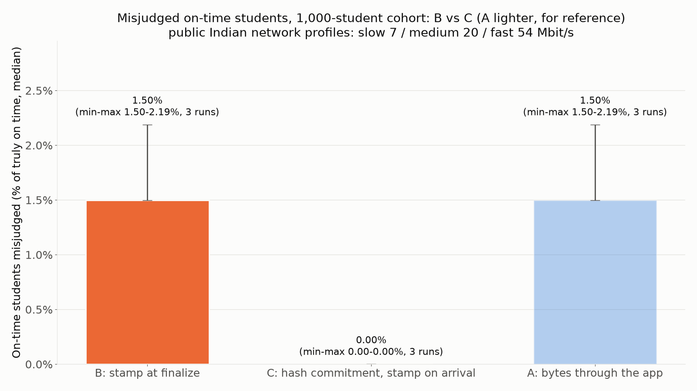
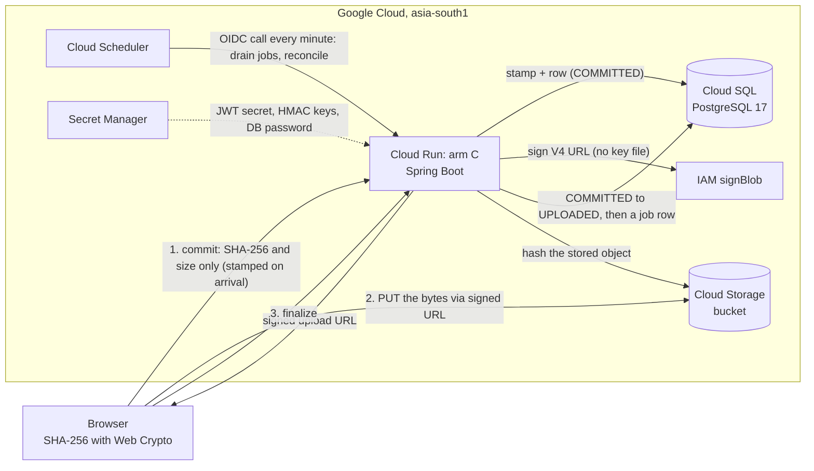

# DeadlineDrop: Bandwidth-Fair Deadline Submissions (hash commitment + direct-to-cloud upload)

[](https://github.com/nirmalraj142007-byte/DeadlineDrop/actions/workflows/ci.yml)

A student on slow Wi-Fi who clicked Submit before the deadline is marked late anyway, because most portals stamp the time when the bytes finish arriving, not when the student clicked.



**Headline (final-10-minute cohort, 1,000 students, public Indian network profiles; there was no student pilot, see D8):**
with the stamp taken at finalize (arm B) the median run misjudged **1.50%** of the students who were truly on time; with the stamp taken when the hash commitment arrives (arm C, same code, same schedule, same network) it misjudged **0.00%** in all three runs. That is about **4.8** expected on-time students misjudged per 1,000-student course for arm B, against 0 for arm C. Source: [`results/headline.md`](results/headline.md).

Watch the 3-minute demo: <VIDEO LINK, filled on day 20>

Run it: `make demo`

## The repeatable sentence

> The intern who showed that even a modern direct-to-cloud upload marks about 5 on-time last-minute submitters late per 1,000-student course for having slow Wi-Fi, and fixed it with a hash commitment.

The "about 5" is the model-scaled 4.8 in the Claims table (arm B, stamp at finalize); arm C, the hash commitment, misjudged 0.

## Architecture



The bytes never pass through the app in arm C. The commit is a few hundred bytes of JSON; the stamp is `committed_at`, set from the injected `Clock` when the request arrives, before any database work. Finalize only checks that the object stored is the one that was committed.

## How the three arms differ

All three are built from the same code and run the same schedule on the same network profiles; only the stamp point and the byte path change.

| Arm | Spring profile | Bytes go through | Stamp taken at | What it shows |
| --- | --- | --- | --- | --- |
| A | `naive` | the app (multipart) | upload completion | the tutorial design; chart only |
| B | `direct-finalize` | Cloud Storage (signed URL) | finalize, after the bytes land | direct upload without the commitment |
| C | none (the real design) | Cloud Storage (signed URL) | commit arrival, before the bytes move | the hash commitment |

The headline is B against C: they differ only in where the stamp is taken. Arm A is in the chart for reference. Cloud Run buffers a whole request body before the container sees it, so arm A's stamp is late by the whole upload ([`results/probe-buffering.md`](results/probe-buffering.md)).

## Claims

Every number on this page is in this table, with the file it comes from and how it was measured. `tools/check-claims.sh` fails if a linked file is missing or a number in the claim is not in that file. (The "3-minute" length of the demo video is a runtime, not a result, and is not a claim.)

| Claim | File | How it was measured |
| --- | --- | --- |
| Arm B, median misclassification at 1,000 students: 1.50% (min-max 1.50%-2.19%, 3 runs) | [`results/headline.md`](results/headline.md) | `tools/summary.py` over the counted B runs at 1,000: truly on time (clicked at least 5 s before the deadline on the k6 VM's NTP-synced clock) but recorded late or missing, divided by truly on time. |
| Arm C, same cohort: 0.00% in all 3 runs, and 0 error cells summed over all 10 counted arm C runs | [`results/headline.md`](results/headline.md) | Same schedule and network as arm B; error cells are on-time-to-late plus late-to-on-time. |
| About 4.8 (the repeatable sentence says about 5) on-time students misjudged by arm B per 1,000-student course (model 4.2, measured over model 1.14) | [`results/headline.md`](results/headline.md) | The model's count at 1x (assumes one third of the course submits in the final 10 minutes) scaled by measured over model cohort rate for B (1.50% over 1.32%). A model-scaled estimate, not a direct count. |
| Arm A, same cohort: 1.50% median, 1.32% model for B, 1.30% model for A | [`results/headline.md`](results/headline.md) | Same method; model from `tools/model/model.py`, pre-registered. A and B misjudged the same students: the error is slow uploads, not load. |
| Arm C commit latency at 1,000 students: p95 192 ms, p99 340 ms, target 500 ms | [`results/headline.md`](results/headline.md) | Median over 3 runs of each run's k6 commit latency percentile. |
| Arm C commit, one 1,000-student run: app 101.0 ms, URL signing 73.0 ms, database 26.0 ms | [`results/runs/20261121T200324Z_C_1000_r1/confusion.json`](results/runs/20261121T200324Z_C_1000_r1/confusion.json) | Server-Timing medians over 1,000 commits; signing (IAM signBlob) is the largest phase. |
| Arm A at 10 instances: 2.19%, 19 misjudged, the same as at 3 instances | [`results/headline.md`](results/headline.md) | Same seed (37744766), 0 connection errors; more instances did not change the result. |
| Counted runs: 41 | [`results/FROZEN.md`](results/FROZEN.md) | Runs whose `meta.json` says counted and valid; frozen on 22 Nov, checked by `tools/check-frozen.sh`. |
| F1, instance halted 60 s before the deadline: arm C 0 of 429 truly on-time misjudged, commit p95 10811.0 ms | [`results/failure/SUMMARY.md`](results/failure/SUMMARY.md) | One run per arm at 500 students; `Runtime.halt` through `/admin/chaos/halt`. |
| F2, browser dies after upload: arm B 48 of 429 misjudged (11.19%), arm C 0 of 429; 47 students never finalized | [`results/failure/SUMMARY.md`](results/failure/SUMMARY.md) | 10% of students skip finalize; arm C's reconciler verified all 47. |
| F2 recovery in arm C: p50 152.4 s, max 172.4 s from upload end to UPLOADED | [`results/failure/SUMMARY.md`](results/failure/SUMMARY.md) | Reconciler, minimum age 2 min, run by Cloud Scheduler every minute, inside a 300 s grace. |
| F3, Cloud SQL restart 90 s before the deadline: arm C 0 of 429 misjudged with 11 receipts issued; without the receipt 0 of 429 too, with 37 commits answered 503 | [`results/failure/SUMMARY.md`](results/failure/SUMMARY.md) | Restart took 10-21 s on this tier; run twice on arm C, receipt on and `RECEIPT_ENABLED=false`. |
| F3 for arms A and B: 9 of 429 misjudged each, the same as with no fault | [`results/failure/SUMMARY.md`](results/failure/SUMMARY.md) | Same schedule; the misjudged students are slow-cohort uploads that finish late. |
| Cold start of arm C: median 14842.6 ms over 5 samples; first request after 19.6 min idle 17007.1 ms | [`results/coldstart.json`](results/coldstart.json) | `curl` timing of `GET /api/time` after Cloud Monitoring showed zero instances; the cold rush then misjudged 0 of 429 at p95 commit 213.4 ms. |
| Cloud Run buffers the whole request: arrival at 164.554 s of a 165.381 s upload | [`results/probe-buffering.md`](results/probe-buffering.md) | 20 MB upload at 125 kB/s to arm A, arrival log against client start. |
| The real bucket refuses an oversize PUT with 400 and a changed content type or object name with 403 | [`results/smoke-bucket.log`](results/smoke-bucket.log) | `tools/smoke-bucket.sh` against the deployed bucket, 2 MiB sent to a 1 MiB signature. |
| Upload cap 25 MB: the verifier hashes the object inside one transaction | [`src/main/java/com/deadlinedrop/jobs/DrainService.java`](src/main/java/com/deadlinedrop/jobs/DrainService.java) | Code comment on the trade-off; the cap itself is enforced in the assignment entity, below. |
| Upload cap in bytes: 26214400 | [`src/main/java/com/deadlinedrop/domain/Assignment.java`](src/main/java/com/deadlinedrop/domain/Assignment.java) | Entity validation on `maxBytes` (the first migration repeats it as a `CHECK`), so no assignment can ask for more. |
| Database pool of 5 connections per instance, 2 s connection timeout | [`src/main/resources/application.yml`](src/main/resources/application.yml) | Configuration (`maximum-pool-size` default 5, `connection-timeout` 2000 ms); not a measurement. |
| Network profiles: slow 7 Mbps, medium 20 Mbps, fast 54 Mbps | [`docs/network-profiles.md`](docs/network-profiles.md) | Published Ookla percentiles (mobile upload p20, mobile p80 or fixed p20, fixed p50); shaped on the k6 VMs with tc and netem. |
| Cloud cost, 1-23 Nov: ₹2,985.57 usage, ₹0 paid after credits | [`results/cost-so-far.md`](results/cost-so-far.md) | Cloud Billing, usage cost before credits, supplied by the owner. Not a per-1,000-submissions figure. |

## Limits

- **F3 (database restart) result.** The restart was short on this tier (10-21 s) and began 90 s before the deadline, so retries had over a minute. Arm C misjudged 0 with the receipt and 0 without it, so the pre-registered prediction that F3 without a receipt would misjudge more than 0 students was **not borne out**; the receipt's measured effect was 11 commits accepted on the first try instead of retried. So the receipt is shown to hold for a restart of about 10-21 s, not for an outage that reaches the deadline. It was run once per configuration (a demonstration, not a rate).
- **A receipt does not cover everything.** If the browser dies after uploading while the database is still down, the object has no row and that submission is lost (D12). Recovery by listing the bucket is designed, not built.
- **Upload cap: 25 MB.** Uploads are one signed PUT (resumable uploads are not built), and the verifier hashes the stored object while holding a database connection from a pool of 5, so the cap keeps that short; the same cap bounds the load generator's memory on its VMs.
- **Single region.** Everything runs in asia-south1; there is no failover and nothing here speaks for other regions.
- **No student pilot.** The 1,000-student cohort is synthetic: network speeds come from published percentiles, and the click curve is a stated assumption (D8, `results/model/model-output.json`).
- **Failure runs are one run each**, at 500 students; they show what happened, not how often.
- **Live deployment.** The cloud deployment is shut down on 26 Nov; `results/` and the demo video are kept, and `make demo` runs the whole system offline.
- **Cost per 1,000 submissions** is not stated: `results/billing/` does not exist yet (phase 40 adds it), and the figure in the Claims table is total usage, not a per-submission cost.

## Non-goals

- **Grading:** the portal records who submitted what, when; judging work is the teacher's job.
- **Plagiarism detection beyond exact duplicates:** it needs content analysis unrelated to fairness at the deadline; even exact cross-student duplicate detection was cut to a stretch goal (D2).
- **AI features:** nothing here needs a model, and a model's output would be unmeasured.
- **Chat:** the portal is a one-way drop box with a receipt; messages belong in the course's existing channel.
- **Mobile app:** the web UI works in a phone browser; a native app adds a build and review pipeline for no change to fairness.
- **Google sign-in:** local accounts with BCrypt and short-lived JWTs avoid a third-party dependency on the deadline path.
- **Payments:** no money moves; adding a provider would add cost and compliance with no benefit to the question measured.
- **Multi-tenancy:** one deployment serves one institution; isolating tenants would multiply the connection budget and the test matrix.

## Deliberately cut

The six cuts made on day 1 (D2) and what replaced them:

| Cut | Replacement |
| --- | --- |
| Cross-student duplicate detection | Stretch goal; nothing built |
| CSV bulk import | An automated database seed script |
| Downloadable receipt file | A web-based receipt page, kept |
| 2,000-student sweep point | Stopped at 1,000 to stay inside the free-tier compute and connection budgets |
| OpenAPI example payloads | Standard generated API documentation, kept |
| Teacher CSV export | Per-file submission inspection and a download-all archive |

## Designed, not built

- **Pub/Sub finalize path:** the bucket would notify the app when an object lands, so finalize would not depend on the browser. The reconciler covers the same gap today, at about a minute's delay.
- **Resumable uploads over 25 MB:** one signed PUT is simple and cannot resume; larger files would need the resumable protocol.
- **Email receipts:** the receipt is a page and an HMAC token; no mail provider is added.
- **Bucket-listing recovery of orphan objects:** walk objects with no row and rebuild the row from signed metadata (D12).
- **Multi-region:** one region keeps latency and the connection budget simple.
- **Per-student rate limits:** the idempotency key makes retries safe, but a student can still repeat commits.

## Links

- [Design](docs/design.md), [prior art](docs/prior-art.md), [decisions](docs/decisions.md)
- [OpenAPI document](docs/openapi.json) (also served at `/v3/api-docs` in the `local` and `cloud` profiles)
- [Tests](docs/tests.md), [UI states](docs/ui-states.md), [demo setup](docs/demo/setup.md)
- [Pre-registered predictions](PREDICTIONS.md) (append-only), [ownership log](docs/ownership-log.md)
- [Evidence layout](results/README.md), [failure tests](results/failure/SUMMARY.md)

## Developing

```bash
cp .env.example .env
# Edit .env and set JWT_SECRET (generate with: openssl rand -base64 48)
make up        # Docker Compose: postgres, app, storage, scheduler
./mvnw verify  # unit + integration tests (needs Docker)
make terms     # banned-terms check
bash tools/check-claims.sh   # every README number traces to results/
```
