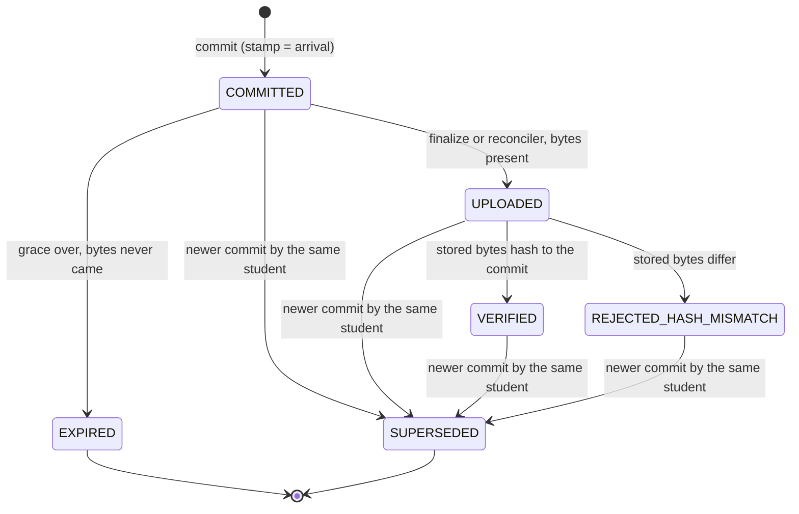
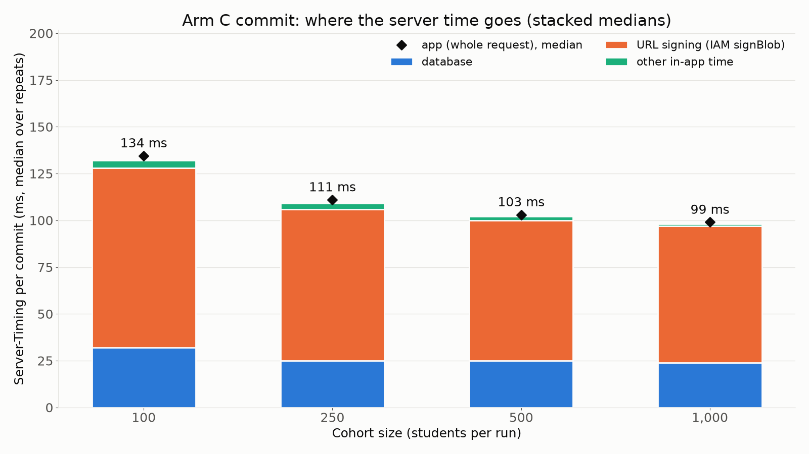

# Design

This is the authoritative description of how DeadlineDrop decides who was on time. Numbers
come from files in `results/` and each carries its path; where something was not measured,
the text says so. Decisions are dated in [decisions.md](decisions.md), predictions are in
[../PREDICTIONS.md](../PREDICTIONS.md), and the evidence layout is in
[../results/README.md](../results/README.md).

## The flow in one paragraph

A student picks a file. The browser computes the file's SHA-256 with Web Crypto and sends a
small **commit** request (hash, size, content type). The server stamps that request on
arrival, inserts a `COMMITTED` row, and answers with a signed Cloud Storage URL. The browser
**transfers** the bytes straight to storage with one PUT. It then calls **finalize**; the
server checks the object that landed against the committed size and moves the row to
`UPLOADED`, and a queued job later hashes the stored bytes and moves it to `VERIFIED` (or
`REJECTED_HASH_MISMATCH`). The stamp taken at commit time is the one that counts; the hash
ties it to exactly those bytes, so the grace window after the deadline admits only bytes that
were already committed.

## The authoritative clock

The time that decides whether a submission is on time is `committed_at`. It is read from the
injected `java.time.Clock` in `CommitTimestampFilter`, which runs at the highest filter
precedence: before security, before request-id handling, before the body is parsed and before
any database work. `db_committed_at` (the database's own `now()`) is stored next to it for
audit only and never takes part in a fairness decision; neither does any other SQL `now()`.
The grace check in the expiry statement is passed the app clock's instant for the same reason.

Why. The question the project asks is "was this click before the deadline?", and the click
reaches the server only through the commit request, so the earliest moment the server can
know about it is that request's arrival. Anything later (after security, after body
parsing, after the connection pool hands over a connection, after the insert) adds latency the
student did not cause: the pool has a 2 s connection timeout, and under a rush a request can
wait there. Reading the clock first keeps pool waits, database stalls and signing time out of
the stamp. The database clock is a second machine with its own skew, and the row can only be
written after the wait; using it would make fairness depend on the slowest component, which is
what arm B does by stamping at finalize. Injecting the `Clock` also lets every integration
test pin the time. When the database is unreachable, the receipt (below) carries the same
arrival stamp in a signed token, so the stamp survives the outage.

## The state machine

Every arrow is one statement of the form `UPDATE submissions SET status = ? ... WHERE id = ?
AND status = <expected>` (`TransitionRepository`), and the caller checks the rows affected.
Only the caller that changed the row writes the event row and enqueues the follow-up job, in
the same transaction (`SubmissionStateMachine`). A caller that lost the race reads the row and
reports what it now says. Two further guards sit beside it: an idempotency key, unique per
student, so a retried commit returns the first answer; and the partial unique index
`ux_live_submission` on (assignment, student) `WHERE status NOT IN ('EXPIRED','SUPERSEDED')`,
so a student can never have two live rows however the commits interleave.

### Why compare-and-set rather than the alternatives

| Approach | What it gives | Why not here |
| --- | --- | --- |
| **`UPDATE ... WHERE id = ? AND status = ?` (used)** | One statement, no read-modify-write window, the database serialises the two writers; rows affected says who won. Needs no lock held across application code. | n/a. |
| `SELECT ... FOR UPDATE`, then check, then `UPDATE` | Also correct. | Holds a row lock and a pooled connection across a round trip to the application, and the pool is 5 connections per instance (`src/main/resources/application.yml`). The guarded `UPDATE` takes the row lock only for the statement. The check-then-write logic also lives in Java, where it is easy to get wrong; with the guard in SQL, `GuardRemovedRaceIT` can prove removing it breaks the invariant. |
| JPA `@Version` (optimistic locking) | Detects a concurrent change at flush time and throws. | The transitions are not entity edits: they run through `JdbcTemplate` on purpose, and `@Version` would turn the expected case (the reconciler and finalize both reach for COMMITTED, and one of them should simply be a no-op) into an exception and a retry loop. The state check is also the business rule (only COMMITTED may become UPLOADED), which a version number does not express. |
| A Redis lock around the transition | Cross-instance mutual exclusion. | Adds a second system to the deadline path, with its own failure modes (lock expiry while the holder is paused, a lost lock service) and a second copy of state that can disagree with the row. The database already serialises the write. Redis is on the "never add" list in `AGENTS.md`. |

The race tests that back this are in `src/test/java/com/deadlinedrop/race/` and summarised in
[tests.md](tests.md): `FinalizeVsReconcilerRaceIT` shows one UPLOADED event and one job from a
race, and `GuardRemovedRaceIT` shows two UPLOADED events once the guard is removed.

## The signed receipt, in one paragraph

If the commit's database block fails because the database cannot be reached, the server still
answers 201 with status `RECEIPT_ISSUED`: the arrival stamp, a signed upload URL, and a token
(base64url payload plus an HMAC-SHA256 over it). The browser uploads as usual and sends the
token in finalize, which verifies it and writes the row with the receipt's stamp in one
transaction (a nonce is unique, so a second redeem replays). The limit that remains is in
[D12](decisions.md): a browser that dies after uploading while the database is still down
leaves an object with no row.

## Failure table

One run per cell, 500 students, same schedule for every arm (`results/failure/SUMMARY.md`). "Misjudged" means truly on time
(clicked at least 5 s before the deadline) but recorded late or missing; there are 429 such students in each of these runs.

| Failure | What was done | Measured result | Where |
| --- | --- | --- | --- |
| Database | Cloud SQL restarted 90 s before the deadline (F3); restart took 10-21 s | Arm C misjudged 0 of 429 with 11 receipts issued, and 0 of 429 without the receipt (37 commits answered 503 and were retried in time). Arms A and B misjudged 9 of 429 each, the same as without a fault. Prediction 7 (more than 0 misjudged without the receipt) was not borne out at this outage length. | `results/failure/SUMMARY.md` |
| Storage | Not injected on the deployed bucket. What was measured: the bucket itself refuses an oversize PUT (400) and a changed content type or object name (403). The app also compares the stored size at finalize (a second line that was not exercised against the real bucket, since it never accepts oversize bytes). | Enforced by Google Cloud Storage at PUT time. A storage outage during a rush was not tested. | `results/smoke-bucket.log`, [D11](decisions.md) |
| IAM signing | Not injected. What was measured: signing is the largest part of every arm C commit. Signing runs after the commit's transaction, so a signing failure keeps the stamp: the row stays COMMITTED with no URL, and the browser asks again at `/api/submissions/{id}/upload-url` (503 `SIGNING_UNAVAILABLE` while it still fails). | Signing 73.0 ms of 101.0 ms app time per commit in one 1,000-student run. No signBlob outage was run. | `results/runs/20261121T200324Z_C_1000_r1/confusion.json` |
| Cloud Scheduler | Not paused during a rush. Scheduler drives the reconciler and the job drain, so it is what recovers a student whose finalize never came (the F2 case). The cold-rush run paused the jobs before it started. | In F2, 47 students never finalized; the reconciler (every minute, minimum age 2 min) moved all 47 to UPLOADED: p50 152.4 s, max 172.4 s after upload end, inside the 300 s grace. A Scheduler outage past the grace would expire those rows; not tested. | `results/failure/SUMMARY.md` |
| Instance | One instance halted with `Runtime.halt` (no shutdown hooks) 60 s before the deadline (F1) | Arm C misjudged 0 of 429; commit p95 rose to 10811.0 ms while the replacement started, then returned to normal. A crash in the last ~15 s (one cold start) could push an on-time click past the deadline; not covered. | `results/failure/SUMMARY.md`, `results/coldstart.json` |
| Cold start | Arm C idle at zero instances; first request, and a 500-student rush after it | First request after 19.6 min idle: 17007.1 ms. Median cold start over 5 samples: 14842.6 ms. The rush after it misjudged 0 of 429 at commit p95 213.4 ms, because the cold start was paid by the logins before the first click. A student who logs in less than about 15 s before clicking would meet it. | `results/coldstart.json` |
| Browser dies after upload | 10% of students skip finalize (F2) | Arm B: 48 of 429 misjudged (11.19%), no row exists for any of the 47. Arm C: 0 of 429, all 47 VERIFIED, stamp from the commit. | `results/failure/SUMMARY.md` |

## Trade-offs, and what was given up

1. **Commit before transfer.** The stamp is taken for a request that is a few hundred bytes, so
   it cannot be delayed by an upload. Given up: an extra round trip before the upload starts,
   and a COMMITTED row for every student who commits and never uploads (they expire after
   grace, and the reconciler handles them).
2. **The browser hashes the file before committing.** Hashing is what binds the stamp to the
   bytes, but it costs the student time before the stamp. Given up: the hash time is on the
   student's side of the click, and the browser has to read the whole file to hash it.
3. **Direct upload through a signed URL, not through the app.** Cloud Run buffers a whole
   request body before the container sees it (`results/probe-buffering.md`: arrival at 164.554 s of
   a 165.381 s upload), so arm A's stamp is late by the whole upload. Given up: the app cannot
   see or refuse bytes in flight; size and type are enforced by the bucket through signed
   headers, and the app learns of the upload only at finalize or through the reconciler.
4. **A transactional job queue in Postgres, drained over HTTP.** A job row is inserted in the same transaction as the transition, so a job exists if and only if the
   transition committed. Given up: latency (a VERIFY job waits for the next drain call, at most about a minute with the
   Scheduler's cadence) and throughput, since Postgres is a modest queue; and a scheduler outage stops the drain.
5. **No cache anywhere** ([D14](decisions.md)). Every hot read is an indexed lookup (`results/explain.md`: all but the teacher dashboard well under 1 ms of execution time).
   Given up: nothing measured yet, but a cache would be a second copy of submission state that
   can disagree with the row the status guard protects.
6. **One database, one region** (asia-south1). Cloud SQL and Cloud Run are in the same region so every call is short and the connection budget is simple. Given up: there is no failover, and
   the cold-start and restart figures describe this tier only.
7. **The receipt trades a stricter 503 for a signed stamp.** During a database outage a commit
   is accepted instead of refused. Given up: an extra code path (a nonce table, HMAC key, stale
   rules) and a case that remains lost (browser dies while the database is down, D12).
8. **Cap of 25 MB, one PUT.** Simple, checkable by the bucket, and short enough to hash inside a
   transaction. Given up: larger submissions (a resumable path is designed, not built).

## What breaks first at 10x

Evidence: the latency-breakdown chart, [`results/charts/latency-breakdown.png`](../results/charts/latency-breakdown.png),
which stacks arm C's per-commit Server-Timing medians (database, URL signing, other in-app time)
for each cohort size. Its values come from each run's `confusion.json`.

What the chart shows: **URL signing (IAM signBlob) is the largest part of every commit**: at
1,000 students it is 73.0 ms of 101.0 ms of app time, against 26.0 ms for the database
(`results/runs/20261121T200324Z_C_1000_r1/confusion.json`). It was already the first
bottleneck candidate in the first cloud runs ([D10](decisions.md)) and it stays the
biggest slice from 100 to 1,000 students while the
commit p95 stayed under the 500 ms target (192 ms at 1,000, `results/headline.md`).

What that implies at 10x, stated as inference, because no run went past 1,000:

- **First: signing.** Each commit makes one remote IAM call that cannot be cached (every
  signature is per object and per student), so ten times the commits is ten times the
  signBlob calls in the same final minute. Its quota and latency under that load were not
  measured, so I do not state a ceiling; the thing to measure is commit latency against signBlob
  calls per second.
- **Second: the connection budget.** Each instance has a pool of 5 and each commit holds a
  connection for the database block (26.0 ms median); the verifier holds one while it hashes an
  object. The Cloud SQL tier caps the sum across instances and arms, and `tools/preflight.sh`
  enforces it (ownership log, phase 35: one instance per arm now). More instances raise the sum; they do not help
  signing, which is per call.
- **Not first: the application and the database queries.** The query plans are all indexed and
  the hot lookups are well under a millisecond (`results/explain.md`), and arm A at ten instances
  did not move its result, so app capacity is not what produced the error there
  (`results/headline.md`).
- **Not a server problem at all:** the arm B and arm A error is slow uploads finishing after
  the deadline, which no server setting shortens; arm C is immune because it stamps earlier.

## Technology cards

### tc + netem

- **Why it is here.** The experiment needs each student's link to behave like a slow, lossy,
  high-latency one, repeatably. `tools/vm/shape.sh` puts `netem` (delay and loss) at the root of the k6 VM's network
  interface and an `fq` queue under it with `maxrate`. Each cohort gets one link: slow 7 Mbit/s
  with 40 ms and 0.1% loss, medium 20 Mbit/s with 25 ms and 0.05%, fast 54 Mbit/s with 10 ms and
  0.01% (`results/sanity/slow-day16.txt` and its siblings).
- **Checked before every sweep.** A shaped-link check must pass within 10% of the rate and 10 ms of the RTT: slow
  measured 6.565 Mbit/s (-6.2%), medium 18.549 (-7.3%), fast 48.899 (-9.4%).
  The fast link reads about 9% under its cap because the shaper counts header bytes, and no fast student was misjudged.
- **Alternative.** Real devices on real networks (the pilot, which did not happen: D8), or a
  packet-level emulator outside the VM.
- **What would make me switch.** A pilot with real students' measured links would replace the
  public profiles with per-student ones; a sanity check that fails the 10% band would mean the kernel cannot shape the link and the harness stops.

### IAM signBlob (V4 signed URLs without key files)

- **Why it is here.** A signed URL lets the browser PUT to the bucket without the app carrying the bytes. Cloud Run's service account
  signs through the IAM `signBlob` API, so there is no service-account key file anywhere (AGENTS.md forbids one). It is also the
  largest phase of a commit (73.0 ms of 101.0 ms in `results/runs/20261121T200324Z_C_1000_r1/confusion.json`).
- **Alternative.** A key file held in Secret Manager (a long-lived secret that can leak), or an
  upload proxy through the app (which is arm A, and loses the fairness).
- **What would make me switch.** Measured signBlob quota or latency becoming the limit at a larger
  cohort (the 10x question above); then signing locally with a short-lived key, or pre-issuing
  URLs at login, would be worth the trade.

### Cloud Scheduler with OIDC

- **Why it is here.** The transactional job queue and the reconciler are drained by an HTTP call: Cloud Scheduler
  calls `/internal/jobs/drain` and `/internal/reconcile` every minute with a Google-signed
  OIDC token for a dedicated service account (`deploy/scheduler.sh`), and the app verifies the token. That keeps the app free of a
  `@Scheduled` thread that would run once per instance and stop when Cloud Run scales to zero.
- **Alternative.** An in-process scheduler, or Cloud Tasks / Pub/Sub for push delivery.
- **What would make me switch.** Wanting finalize without the browser (the Pub/Sub path in the README's "Designed, not built") or needing recovery faster than a minute; F2 recovered in
  152.4 s at p50 (`results/failure/SUMMARY.md`), which is slow only because of the reconciler's 2 min minimum age.

### `FOR UPDATE SKIP LOCKED`

- **Why it is here.** A job is claimed with `SELECT ... WHERE status = 'PENDING' AND run_after <= ? ORDER BY run_after
  LIMIT 1 FOR UPDATE SKIP LOCKED` (`JobRepository`), so several drainers never run the same job and never wait for each other. The claim, the
  hash and `markDone` share one transaction, so a crashed drainer simply releases its lock and the
  job runs again with no "in progress" state to clean up. The claim is served by the index `ix_jobs_ready` (`results/explain.md`).
- **Alternative.** A distributed lock, a message broker, or an advisory lock per job.
- **What would make me switch.** A queue deep enough that polling Postgres shows up in the query plan, or a need for
  fan-out to many consumers; neither appeared in any measured run.

### Redis and Kafka

- **Why they are not here.** Nothing measured needs them. The state is one row per submission, the
  hot reads are indexed lookups (`results/explain.md`), and a second system would add a failure
  mode to the deadline path and a second copy of state (D14). `AGENTS.md` forbids adding either.
- **Alternative.** In-process memoisation for the teacher dashboard, and the Postgres queue for jobs.
- **What would make me switch.** A measured read bottleneck that an in-process map
  cannot fix (for example many instances polling one dashboard, where [D14](decisions.md) already
  sketches a 2 s in-process cache first), or a queue that needs replay or many independent consumers.
