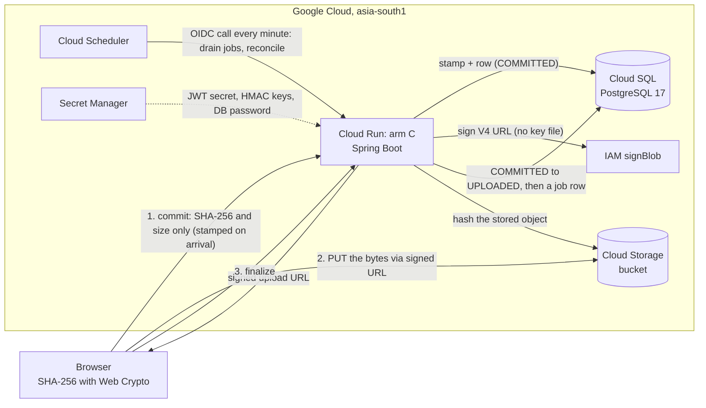
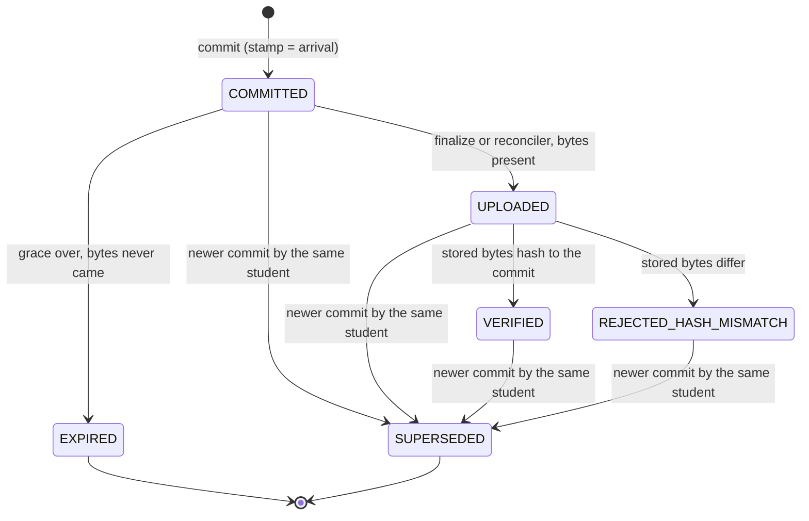
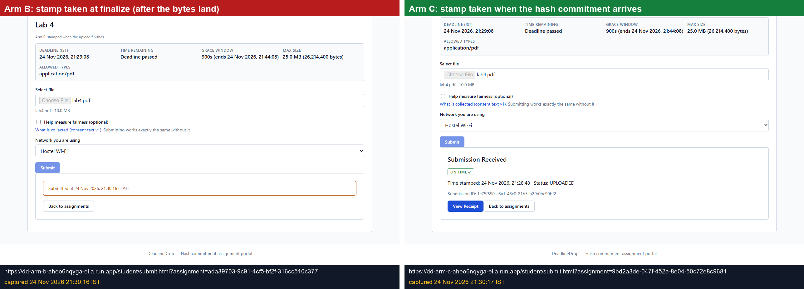
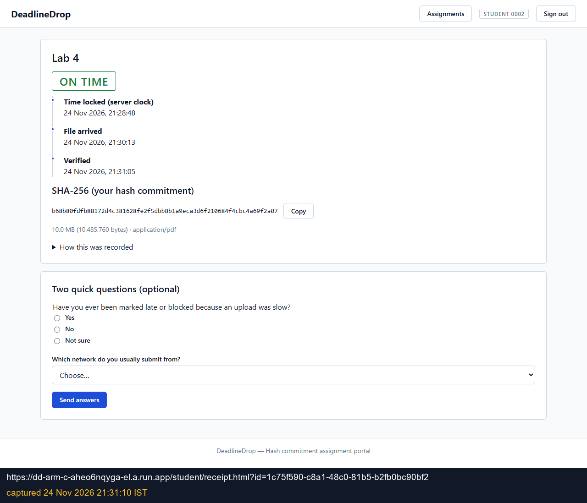
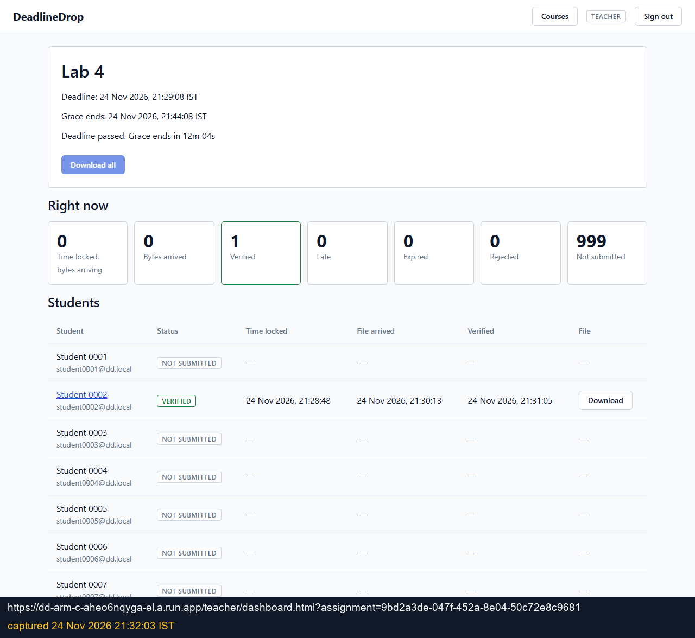
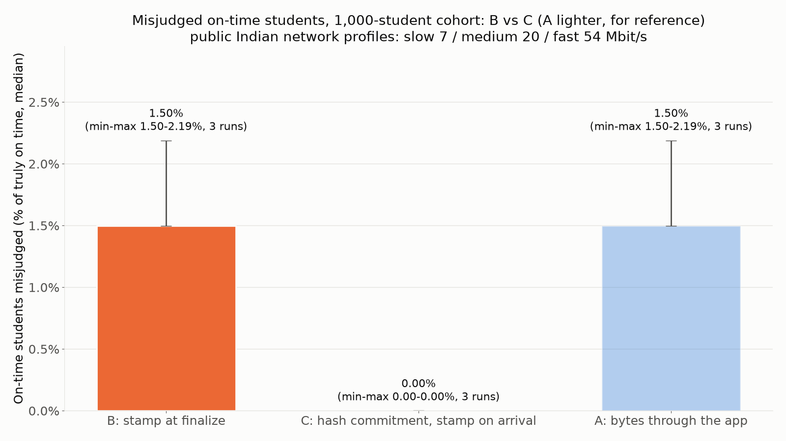
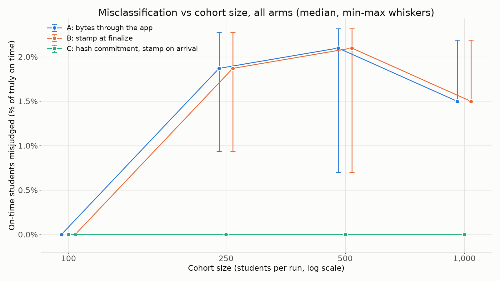
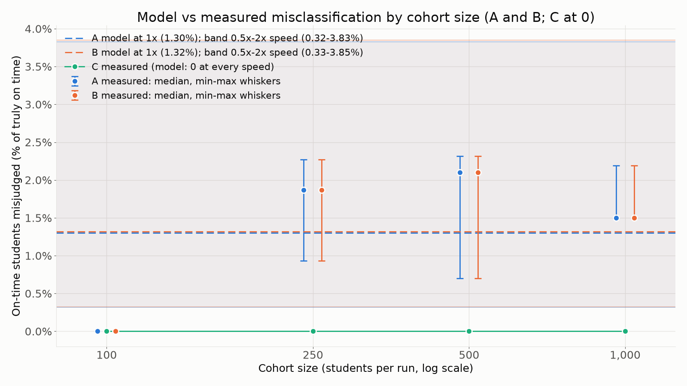
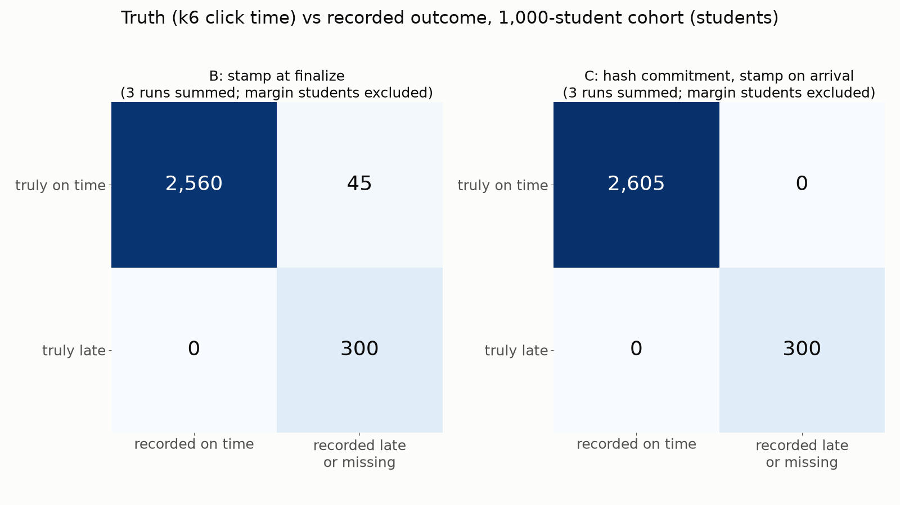

# DeadlineDrop: Bandwidth-Fair Deadline Submissions

**Project report.** Hash commitment + direct-to-cloud upload, measured as a three-arm ablation on
Google Cloud (asia-south1). Author: Nirmal. Period: 6-27 Nov 2026; the cloud deployment ran
6-25 Nov 2026 and was shut down on 25 Nov 2026.

Every number in this report comes from a file in `results/` (or, where a line says so, from the
file that line cites). `tools/check-claims.sh` fails the build if a number in this file is not in
those files. Where something was not measured, the text says so.

---

## 1 Introduction

### 1.1 The 11:58:30 student

The deadline is 11:59 pm. A student in a hostel on slow Wi-Fi finishes a 15 MB report and clicks
Submit at 11:58:30, thirty seconds early. On a slow uplink the upload takes longer than that. Most
portals stamp the submission when the bytes finish arriving, so the student is marked late for
having slow Wi-Fi, not for being late. Nothing they did after the click changed when they clicked.

DeadlineDrop separates the two. The browser computes the file's SHA-256 and sends a tiny commit
request (hash, size, type). The server stamps that request **on arrival**, before any bytes move.
The bytes then go straight to Cloud Storage through a signed URL, and a later finalize checks that
the stored object is the one that was committed. The hash binds the early stamp to exactly those
bytes, so a grace window after the deadline can admit only bytes that were already committed. This
is a **hash commitment**.

### 1.2 Objectives

1. Build a working submission portal (students, teachers, an admin) whose deadline stamp does not
   depend on upload speed.
2. Measure the unfairness it removes, against two baselines built from the same code: arm A
   (bytes through the app, stamped at upload completion) and arm B (direct signed-URL upload,
   stamped at finalize). The headline is B against C, because they differ only in where the stamp
   is taken.
3. Pre-register predictions before any counted run, and report the ones that were wrong.
4. Show that the design stays correct under failure: an instance crash (F1), a browser that dies
   after uploading (F2) and a database restart (F3).

### 1.3 Scope

In scope: one region (asia-south1), one institution, files up to 25 MB, a final-10-minute cohort
of up to 1,000 simulated students on network profiles taken from published Indian measurements
(Ookla open data). Out of scope: grading, plagiarism detection, Google sign-in, email, payments,
mobile apps, multi-tenancy (README "Non-goals").

There was **no student pilot** (decision D8, `docs/decisions.md`): no course instructor confirmed
by the day-5 gate, so the network inputs are public profiles and the click curve is a stated
assumption, tested at half and double speed in the model. The project was demonstrated with live
screenshots of the deployed system instead of a video (phase 39).

---

## 2 Requirements

### 2.1 Roles

| Role | Can do |
| --- | --- |
| Student | See enrolled assignments with a server-synced countdown, submit a file, read the receipt (stamp, timeline, SHA-256). |
| Teacher | Create courses and assignments (deadline, grace, size cap, allowed types), enrol students, watch a live dashboard, inspect and download submissions, export an assignment. |
| Admin | Read the deployment (arm, server time, clock skew) and, only when chaos is enabled, halt an instance for the F1 test. |
| Cloud Scheduler | Call the two internal endpoints (drain the job queue, run the reconciler) with an OIDC token. |

### 2.2 Functional requirements

- **FR1 Commit.** A student commits a file's SHA-256, size and content type; the server stamps the
  request on arrival and answers with a signed upload URL. A retried commit with the same
  `Idempotency-Key` returns the first answer.
- **FR2 Upload.** The browser PUTs the bytes to Cloud Storage through the signed URL; the bucket
  enforces size, content type and object name.
- **FR3 Finalize.** The browser reports the upload; the server checks the stored object's size and
  moves the submission to UPLOADED.
- **FR4 Verify.** A queued job hashes the stored object and moves the submission to VERIFIED or
  REJECTED_HASH_MISMATCH.
- **FR5 Recover.** If finalize never comes (browser closed), the reconciler finds the object and
  completes the submission; a commit whose bytes never arrive expires when grace ends.
- **FR6 Resubmit.** A new commit by the same student supersedes the old one; a student never has
  two live submissions.
- **FR7 Receipt.** The student sees ON TIME or LATE, the stamp and the hash; if the database is
  unreachable at commit time, the server issues a signed receipt carrying the arrival stamp.
- **FR8 Teacher views.** Dashboard (polled, ETag), per-submission detail with events, download one
  or all, export.

### 2.3 Non-functional requirements

| Requirement | Target | Measured | Source |
| --- | --- | --- | --- |
| Fairness | 0 truly on-time students recorded late or missing in arm C | 0 error cells summed over all 10 counted arm C runs | `results/headline.md` |
| Commit latency | p95 under 500 ms at 1,000 students | p95 192 ms, p99 340 ms | `results/headline.md` |
| Cold-rush commit latency | p95 under 5 s | p95 213.4 ms | `results/coldstart.json` |
| Integrity | 0 lost, 0 duplicates | 0 and 0 in every counted run | `results/SUMMARY.md` |
| Database pool | 5 connections per instance, connection timeout 2000 ms | configuration, not a measurement | `src/main/resources/application.yml` |
| Upload cap | 26214400 bytes | enforced by the entity and a `CHECK` | `src/main/java/com/deadlinedrop/domain/Assignment.java` |
| Cost | inside the free-trial credit | ₹3,121.37 usage, ₹0 paid | [`results/billing/billing-final.md`](../../results/billing/billing-final.md) |
| Accessibility | WCAG-style labels, contrast, reduced motion | Lighthouse accessibility 100 on S3, S4, S7 | [`docs/ui-states.md`](../ui-states.md) |

---

## 3 System design

### 3.1 Architecture



One Spring Boot application serves the static UI and the REST API. In arm C the bytes never pass
through the application: the commit is a few hundred bytes of JSON. Cloud Run buffers a whole
request body before the container sees it, which is why arm A, the tutorial multipart design, is
late by the whole upload: arrival at 164.554 s of a 165.381 s upload ([`results/probe-buffering.md`](../../results/probe-buffering.md)).

The three arms are one codebase with Spring profiles:

| Arm | Profile | Bytes go through | Stamp taken at |
| --- | --- | --- | --- |
| A | `naive` | the app (multipart) | upload completion |
| B | `direct-finalize` | Cloud Storage (signed URL) | finalize, after bytes land |
| C | none (the real design) | Cloud Storage (signed URL) | commit arrival, before bytes move |

### 3.2 The hash commitment

1. The browser reads the file and computes SHA-256 with Web Crypto (`crypto.subtle.digest`).
2. `POST /api/assignments/{assignmentId}/commits` with the hash, size and type. `CommitTimestampFilter`
   reads the injected `Clock` before security, body parsing or any database work; that instant is
   `committed_at`, the authoritative stamp. The database's own time is stored as
   `db_committed_at` for audit only and never decides anything.
3. The server inserts a COMMITTED row and signs a V4 URL bound to the object name, content type and
   exact size range (IAM signBlob, no key file).
4. The browser PUTs the bytes to the bucket.
5. `POST /api/submissions/{id}/finalize`: the server stats the object, compares sizes, and moves
   COMMITTED to UPLOADED, enqueueing a VERIFY job in the same transaction.
6. The drain endpoint, called by Cloud Scheduler, claims the job, hashes the stored object and
   moves the row to VERIFIED, or to REJECTED_HASH_MISMATCH if the bytes differ from the commitment.

On time means `committed_at` is before the deadline. The grace window only lets the upload and
finalize finish; bytes that hash to something else are rejected, so grace cannot be used to submit
new work.

### 3.3 State machine



Every arrow is one conditional `UPDATE ... WHERE id = ? AND status = <expected>`; the caller checks
the rows affected, and only the winner writes the event and enqueues the follow-up job. Two more
guards sit beside it: the idempotency key is unique per student, and the partial unique index
`ux_live_submission` on (assignment, student) `WHERE status NOT IN ('EXPIRED','SUPERSEDED')` makes
two live rows impossible. Chapter 4 shows the statement; chapter 6 shows the test that proves the
guard matters.

### 3.4 Schema

Six forward-only Flyway migrations (`src/main/resources/db/migration/`), applied with
`ddl-auto=validate`:

| Migration | Tables and indexes |
| --- | --- |
| V1 users, courses, assignments | `users`, `courses`, `enrollments`, `assignments` (deadline, grace, size cap as a `CHECK`, allowed types) |
| V2 submissions state machine | `submissions` (status enum, `committed_at`, `db_committed_at`, hash, size, idempotency key), `submission_events`, `ux_live_submission` |
| V3 jobs | the transactional job queue table and `ix_jobs_ready` |
| V4 telemetry and survey | anonymised telemetry and the receipt-page survey |
| V5 baseline submissions | rows for arms A and B |
| V6 receipt nonce | single-use nonces for the signed receipt |

### 3.5 API summary

The full document is [`docs/openapi.json`](../openapi.json) (also served at `/v3/api-docs` in the
`local` and `cloud` profiles).

| Area | Endpoints |
| --- | --- |
| Auth | `POST /api/auth/login`, `GET /api/me` |
| Time and config | `GET /api/time`, `GET /api/config` |
| Courses | `GET/POST /api/courses`, `POST /api/courses/{id}/enrollments`, `GET/POST /api/courses/{courseId}/assignments` |
| Assignments | `GET/PATCH /api/assignments/{id}`, `GET /api/me/assignments`, `GET /api/assignments/{id}/dashboard`, `.../export`, `.../download-all` |
| Submission flow | `POST /api/assignments/{assignmentId}/commits`, `POST /api/submissions/{id}/upload-url`, `POST /api/submissions/{id}/finalize` |
| Submission reads | `GET /api/submissions/{id}`, `GET /api/submissions/{id}/download` |
| Telemetry | `POST /api/telemetry`, `POST /api/survey` |
| Internal (OIDC) | `POST /internal/jobs/drain`, `POST /internal/reconcile` |

---

## 4 Implementation

### 4.1 Layering

Base package `com.deadlinedrop`: `api` (controllers), `api.dto` (records), `service`, `repository`,
`domain`, `storage`, `security`, `jobs`, `web` (filters), `chaos`, `telemetry`, `config`. ArchUnit
tests enforce the rules: `api` never touches `repository`, `repository` never touches `service` or
`api`, `domain` never touches `api`, and there is no field injection. JPA (Spring Data) handles
users, courses, enrolments and assignments; every submission state change and the job queue use
`JdbcTemplate`, because a transition is a guarded SQL statement, not an entity edit.

### 4.2 DTOs

Requests and responses are Java records in `api.dto`, validated with Bean Validation. JPA entities
never leave the service layer, so a change to an entity cannot leak a field into the API.

### 4.3 Security

Spring Security as an OAuth2 resource server with HS256 JWTs issued at login (passwords hashed with
BCrypt; token lifetime `PT12H` in `src/main/resources/application.yml`). Every controller method
carries `@PreAuthorize` or the project's `@PublicEndpoint`. The internal endpoints accept only a
Google-signed OIDC token for the scheduler's service account. The signed upload URL is the only
credential the browser gets for storage, and it is bound to one object name, one content type and
one size range. Secrets come from environment variables locally and Secret Manager in the cloud;
none are in git (gitleaks runs in CI).

### 4.4 Error handling

Every error is an RFC 9457 `ProblemDetail` with a `code` (constants in `api/ErrorCodes`, for
example `IDEMPOTENCY_KEY_REUSED`, `SIZE_MISMATCH`, `GRACE_OVER`, `DATABASE_UNAVAILABLE`) and a
`requestId`. No stack trace reaches a response. When the database cannot be reached the answer is
`503` with `Retry-After: 1`, and the browser retries with the same idempotency key. Configuration is
validated at startup (`@ConfigurationProperties` + `@Validated`), so a missing secret stops the app
with a clear message instead of failing at the deadline.

### 4.5 Migrations

Flyway, forward-only: an applied migration is never edited, and the evidence freeze
(`tools/check-frozen.sh`) rejects any change to `db/migration/` after tag `evidence-frozen`.

### 4.6 Storage port

`StoragePort` has two adapters: `GcsStorageAdapter` (V4 signed URLs signed through IAM signBlob,
object stat, streamed hashing) and `LocalStorageAdapter`, which talks to a separate local storage
server (the `storage` profile) that checks HMAC-signed URLs and enforces size and content type like
the real bucket. Integration tests and the offline demo use the local server; nothing in a test
mocks storage.

### 4.7 Code excerpt: the commit filter

The stamp is read before anything else runs (`src/main/java/com/deadlinedrop/web/CommitTimestampFilter.java`):

```java
@Component
@Order(Ordered.HIGHEST_PRECEDENCE)
public class CommitTimestampFilter extends OncePerRequestFilter {
    private static final String COMMIT_PATH = "/api/assignments/*/commits";
    private final Clock clock;

    @Override
    protected void doFilterInternal(HttpServletRequest request, HttpServletResponse response,
                                    FilterChain filterChain) throws ServletException, IOException {
        if (HttpMethod.POST.matches(request.getMethod())
                && pathMatcher.match(COMMIT_PATH, request.getRequestURI())) {
            request.setAttribute(ARRIVED_AT, clock.instant());
        }
        filterChain.doFilter(request, response);
    }
}
```

Why first: anything later (authentication, body parsing, waiting for a pooled connection, the
insert) adds delay the student did not cause. Injecting `Clock` also lets every integration test pin
the time.

### 4.8 Code excerpt: the conditional UPDATE

Every transition (`src/main/java/com/deadlinedrop/repository/TransitionRepository.java`):

```java
private static final String TRANSITION_SQL =
    "UPDATE submissions SET status = ?::submission_status, updated_at = ?, "
  + "uploaded_at = CASE WHEN ?::submission_status = 'UPLOADED' THEN ? ELSE uploaded_at END, "
  + "verified_at = CASE WHEN ?::submission_status = 'VERIFIED' THEN ? ELSE verified_at END, "
  + "expired_at = CASE WHEN ?::submission_status = 'EXPIRED' THEN ? ELSE expired_at END "
  + "WHERE id = ? AND status = ?::submission_status";

/** Moves {@code id} from {@code from} to {@code to}; returns rows affected (0 or 1). */
public int transition(UUID id, Status from, Status to, Instant now) {
    OffsetDateTime ts = utc(now);
    return jdbcTemplate.update(TRANSITION_SQL,
        to.name(), ts, to.name(), ts, to.name(), ts, to.name(), ts, id, from.name());
}
```

When finalize and the reconciler both try COMMITTED to UPLOADED, the database serialises the two
statements; one sees one row affected and does the follow-up work, the other sees zero and just
reads the row. No lock is held across application code, which matters with a pool of 5
connections. The alternatives (`SELECT ... FOR UPDATE`, JPA `@Version`, a Redis lock) and why they
were not used are in [`docs/design.md`](../design.md).

---

## 5 User interface

Static HTML, CSS and vanilla ES modules served by the app (`src/main/resources/static/`): no
framework, no build step, no CDN, no inline scripts. Every screen has empty, loading, error, partial
and success states, walked in a real Chrome and recorded in [`docs/ui-states.md`](../ui-states.md).

### 5.1 Screenshots from the live deployment

Captured on 24 Nov 2026 from the live Cloud Run arms B and C (phase 39), with the page URL and the
capture time burned into each image. They illustrate the system; they are not measurements.



*The race: same student, same file, same throttled link, one assignment. Arm B stamps at finalize
and says LATE; arm C stamped when the hash commitment arrived and says ON TIME.*



*Student receipt (S4): time locked before the file arrived, then file arrived, then verified, with
the SHA-256 the browser committed to.*



*Teacher dashboard (S7): the submission is verified, with the three stamps per student.*

### 5.2 Every screen

The cloud was shut down before the remaining screens were captured, so the other screens are
described from the walkthrough (`docs/ui-states.md`, local stack, 24 Nov 2026) rather than shown;
`make demo` brings them all up offline.

| Screen | Who | What it does |
| --- | --- | --- |
| S1 Login | all | Email and password; students land on assignments, teachers on courses, admins on the console. |
| S2 Assignments | student | Enrolled assignments with a countdown synced to `/api/time` and the submission status. |
| S3 Submit | student | Pick a file; progress reads "Locking your submission time…", "Time locked ✓", "Confirming submission bytes…", then ON TIME or LATE. |
| S4 Receipt | student | Stamp, timeline, SHA-256 with Copy; polls until VERIFIED. |
| S5 Courses | teacher | Course list and create form. |
| S6 Assignment form | teacher | Title, deadline (shown back in IST), grace, size cap, allowed types. |
| S7 Dashboard | teacher | Tiles by status, one row per student with the three stamps, download all; polled with an ETag. |
| S8 Submission detail | teacher | Timeline, hash, size, type, download, event table. |
| S9 Admin console | admin | Arm, server time, clock skew, chaos status and the halt button for F1. |

### 5.3 Flows

- **Student:** S1 → S2 → S3 (hash, commit, upload, finalize) → S4. The stamp is fixed at the
  commit step, which the progress text names ("Time locked") so the student knows the upload no
  longer decides the outcome.
- **Teacher:** S1 → S5 → S6 (create the assignment) → S7 (watch the rush) → S8 (inspect one
  submission) → download all.

Accessibility: labelled fields, live regions for progress, an ordered-list timeline, visible focus
outlines and `prefers-reduced-motion` handling; Lighthouse accessibility scored 100 on S3, S4 and S7
([`docs/ui-states.md`](../ui-states.md)).

---

## 6 Testing

Counts are test methods in `src/test/java` on 24 Nov 2026 ([`docs/tests.md`](../tests.md)):

| Kind | Classes | Methods | What it covers |
| --- | --- | --- | --- |
| Unit (`*Test`, surefire) | 7 | 44 | pure logic: deadline policy, the commit filter, error mapping, OIDC tokens, the GCS adapter, config, ArchUnit layering rules |
| Integration (`*IT`, failsafe) | 29 | 208 | every endpoint and service against Testcontainers Postgres and the real local storage server; database outages with Toxiproxy |
| Race / concurrency (`race/*IT`) | 6 | 12 | the invariants below |
| End-to-end (k6 against the compose stack) | 2 scripts | 2 | the whole flow over HTTP |

The database, the state machine and storage are never mocked.

### 6.1 Race tests and what each proves

- `DuplicateRetryIT`: 20 simultaneous copies of one commit (same `Idempotency-Key`) create exactly
  one submission; the other 19 replay it.
- `ExpiryAtGraceEndIT`: a commit whose bytes never came is COMMITTED just before grace ends and
  EXPIRED just after, and late bytes cannot bring it back.
- `FinalizeVsReconcilerRaceIT`: finalize and the reconciler racing on COMMITTED to UPLOADED produce
  exactly one UPLOADED event and one VERIFY job.
- `GuardRemovedRaceIT`: with the `AND status = ?` guard removed, the same race writes two UPLOADED
  events. This proves the race test can fail, so it is never weakened.
- `JobEnqueueAtomicityIT`: if enqueueing the VERIFY job fails, the transition rolls back with it.
- `SupersedeOnResubmitIT`: two new commits at the same moment never leave two live rows.

### 6.2 End-to-end

`make e2e` builds and starts the compose stack, seeds 20 students and runs two k6 scripts
([`docs/tests.md`](../tests.md)): the happy path (commit a 2 MB file, upload, finalize, wait for
VERIFIED, check the dashboard and that the downloaded bytes hash to the commitment) and a failure
path (5 students click while Postgres is paused for 10 s; all end VERIFIED with one live row each).

### 6.3 CI

GitHub Actions on every push (`.github/workflows/ci.yml`): the evidence-freeze check, the banned
terms check, `./mvnw verify` (unit, integration and race tests), gitleaks over the history,
OSV-Scanner on the dependencies (the build fails on any new finding), and `make e2e`.

---

## 7 Deployment

### 7.1 Google Cloud setup

All in asia-south1, project `deadlinedrop-nirmal`:

- **Cloud Run:** three services, `dd-arm-a`, `dd-arm-b`, `dd-arm-c`, with identical CPU, memory,
  concurrency, instance limits and pool size (`tools/parity.sh` had to be clean before every run).
- **Cloud SQL:** one PostgreSQL 17 instance, one database per arm (`dd_a`, `dd_b`, `dd_c`). The
  connection budget (sum of instances times pool size across arms, at most `max_connections` minus
  5) was enforced by `tools/preflight.sh`.
- **Cloud Storage:** one bucket; uploads through V4 signed URLs signed with IAM signBlob. No
  service-account key was ever created; deployment used Workload Identity Federation from GitHub.
- **Cloud Scheduler:** two jobs (`dd-drain-c`, `dd-reconcile-c`) calling arm C's drain and
  reconcile endpoints every minute with OIDC.
- **Secret Manager:** JWT secret, receipt HMAC key, telemetry salt, database password.
- **Load generation:** three Compute Engine VMs, one per network cohort, NTP-synced and shaped with
  `tc` + `netem` to the public profiles
  (slow 7 Mbps, medium 20 Mbps, fast 54 Mbps, [`docs/network-profiles.md`](../network-profiles.md)).

### 7.2 Configuration

Profiles: `local` (Docker Compose), `test`, `cloud`, `naive` (arm A), `direct-finalize` (arm B),
`storage` (the local storage server), `seed`; arm C runs with no arm profile. Settings come from
environment variables; `.env.example` is tracked and `.env` is git-ignored. The full configuration
of every deployed resource was saved before shutdown in `results/cloud-inventory/`.

### 7.3 Cost

Usage cost before credits, 1-25 Nov 2026, from the Cloud Billing report
([`results/billing/billing-final.md`](../../results/billing/billing-final.md)):

| Service | Usage cost | Source |
| --- | ---: | --- |
| Compute Engine (k6 VMs) | ₹1,565.54 | [`billing-final.md`](../../results/billing/billing-final.md) |
| Cloud SQL | ₹1,172.06 | [`billing-final.md`](../../results/billing/billing-final.md) |
| Cloud Run | ₹246.00 | [`billing-final.md`](../../results/billing/billing-final.md) |
| Networking | ₹52.28 | [`billing-final.md`](../../results/billing/billing-final.md) |
| Cloud Storage | ₹48.01 | [`billing-final.md`](../../results/billing/billing-final.md) |
| Artifact Registry | ₹37.48 | [`billing-final.md`](../../results/billing/billing-final.md) |
| **Total** | **₹3,121.37** | paid ₹0 (free-trial credits) |

**Cost per 1,000 submissions: ₹131.98** (₹3,121.37 over 23,650 submissions in the 45 counted runs,
`results/billing/cost-per-1000.md`). This is an **upper bound**: the bill also covers 25 days of
development, idle Cloud SQL, the k6 VMs and dry runs, so it is not the marginal cost of a
submission.

### 7.4 Why the link is gone, and where the proof lives

The deployment ran live 6-25 Nov 2026 and was shut down on 25 Nov 2026, the day before the
free-trial credit ended (decision D16, `docs/decisions.md`). Every billable resource was deleted
with `tools/shutdown.sh`, which needs a typed confirmation per group. What remains:

- `results/` (frozen at tag `evidence-frozen`): every counted run's raw logs, export and confusion
  matrix, the failure tests, the cold-start data, the model and the bill.
- `results/cloud-inventory/`: describe output of every deleted resource (secrets redacted) and the
  empty listings after shutdown.
- `results/backup/`: `pg_dump` of the three arm databases and a listing of the bucket.
- `docs/screenshots/`: the live screenshots in chapter 5.
- `make demo`: the whole system offline (two arm C replicas behind nginx, arm B, Postgres, the
  local storage server, a scheduler), [`docs/demo/setup.md`](../demo/setup.md).

---

## 8 Evaluation

### 8.1 Method

- **Ground truth** is the k6 click time on NTP-synced VMs. A student is *truly on time* if they
  clicked at least 5 s before the deadline T; clicks in the last 5 s before T are reported apart.
  *Misjudged* means truly on time but recorded late or missing.
- **Cohort:** the final 10 minutes before the deadline (N fixed at 10 in PREDICTIONS.md addendum 2,
  because there was no pilot).
  A 1,000-student run has 900 students on a convex click curve and 100 who click after T (`PREDICTIONS.md`).
- **Network:** three cohorts shaped to published Indian Ookla percentiles
  ([`docs/network-profiles.md`](../network-profiles.md)).
- **Arms:** A, B and C from the same code, same schedule, same network, same Cloud Run and Cloud SQL
  settings.
- **Counted runs** are never edited or re-run for a better number; a run marked invalid for an
  infrastructure reason was repeated and both folders kept (`results/SUMMARY.md`).

### 8.2 Headline

Arm B's cohort rate (1.50%) is under 5%, so the pre-registered fallback rule applies: the headline
leads with the count per 1,000-student course and the B-versus-C ablation, and the cohort is not
widened to raise the number (`results/headline.md`).

- **About 5 on-time students misjudged per 1,000-student course by arm B** (4.8: the model's 4.2
  at 1x, scaled by measured over model cohort rate, 1.50% over 1.32% = 1.14). This is a
  model-scaled estimate, not a direct count.
- **Arm B misjudged 1.50%** of truly on-time students in the median 1,000-student run (3 runs,
  min-max 1.50%-2.19%; 19, 13 and 13 of 868, 869 and 868).
- **Arm C misjudged 0.00%** in the same runs, and 0 error cells summed over all 10 counted arm C
  runs.
- **Adding instances did not help the baseline:** arm A at 10 instances misjudged 2.19% (19 students)
  on the same schedule as at 3 instances, also 2.19% (19), with 0 connection errors. The error is
  slow uploads finishing after the deadline, which no server capacity shortens.



### 8.3 Pre-registered predictions against results

Predictions were committed on day 1 (6 Nov 2026) and addendum 2 before the first counted sweep
(`PREDICTIONS.md`, append-only).

| # | Prediction | Result | Verdict |
| --- | --- | --- | --- |
| 1 | Arm A, 1,000-student cohort: 15-35% misclassified (`PREDICTIONS.md`) | 1.50% median (`results/headline.md`) | **Wrong.** Made before the public profiles existed; addendum 2's model put A at 1.30%. |
| 2 | Arm A, fast clients only: under 2% | Not run as a separate arm. | Not tested. |
| 3 | Arm B close to the model; load adds under 3 points | Measured minus model +0.18 points (`results/headline.md`) | Borne out. |
| 4 | Arm C: 0 on-time-to-late, 0 late-to-on-time, 0 lost, commit p95 under 500 ms; cold-rush p95 under 5 s | 0, 0, 0; p95 192 ms; cold-rush p95 213.4 ms (`results/headline.md`, `results/coldstart.json`) | Borne out. |
| 5 | First bottleneck: IAM URL signing or the connection pool | Signing was the largest part of every arm C commit: 73.0 ms of 101.0 ms app time ([`confusion.json`](../../results/runs/20261121T200324Z_C_1000_r1/confusion.json)); no run reached a limit. | Borne out as the leading candidate; no bottleneck was hit at 1,000. |
| 6 | Arm A at 10 instances: rate moves by under 3 points | 2.19% at 10 instances and at 3 (`results/headline.md`) | Borne out (moved 0 points). |
| 7 | F3 database restart without a signed receipt: more than 0 misjudged | 0 of 429 (`results/failure/SUMMARY.md`) | **Wrong.** See section 8.7. |

"Would embarrass me" (day 1): *arm B under 3% in the cohort* happened (1.50%). Addendum 2 saw it
coming from the model before any counted run, which is why the fallback rule, not a widened
cohort, decides the headline. The other two (any lost submission in F1, any arm C late-to-on-time)
did not happen: 0 lost in F1, 0 late-to-on-time in arm C (`results/failure/SUMMARY.md`).

### 8.4 Three arms

Counted fault-free sweep, one row per run in `results/SUMMARY.md`. At 1,000 students:

| Arm | Run 1 | Run 2 | Run 3 | Median |
| --- | ---: | ---: | ---: | ---: |
| A (multipart, stamp at upload end) | 19 of 868 | 13 of 869 | 13 of 868 | 1.50% |
| B (signed URL, stamp at finalize) | 19 of 868 | 13 of 869 | 13 of 868 | 1.50% |
| C (hash commitment, stamp at commit) | 0 of 868 | 0 of 869 | 0 of 868 | 0.00% |

A and B misjudged the same students: once Cloud Run buffers the request (arm A) or the stamp waits
for finalize (arm B), both stamp after the upload ends. Arm C stamps before it starts.



### 8.5 Model against measurement

The analytic model (`tools/model/model.py`, pre-registered in addendum 2) predicted A 1.30%, B 1.32%,
C 0.00% at 1x. Measured minus model at 1,000: A +0.19 points, B +0.18 points (`results/headline.md`).
The model has no load, so this small gap is the load-induced error; it is well inside the 3 points
prediction 3 allowed.



### 8.6 Confusion matrices

One 1,000-student run of each of B and C on the same schedule
([B](../../results/runs/20261121T193710Z_B_1000_r1/confusion.json),
[C](../../results/runs/20261121T200324Z_C_1000_r1/confusion.json)); rows are the truth from the k6
clock, columns what the portal recorded.

| Arm B, run 1 | Recorded on time | Recorded late or missing | Source |
| --- | ---: | ---: | --- |
| Truly on time (868) | 849 | 19 | [`confusion.json`](../../results/runs/20261121T193710Z_B_1000_r1/confusion.json) |
| Truly late (100) | 0 | 100 | [`confusion.json`](../../results/runs/20261121T193710Z_B_1000_r1/confusion.json) |

| Arm C, run 1 | Recorded on time | Recorded late or missing | Source |
| --- | ---: | ---: | --- |
| Truly on time (868) | 868 | 0 | [`confusion.json`](../../results/runs/20261121T200324Z_C_1000_r1/confusion.json) |
| Truly late (100) | 0 | 100 | [`confusion.json`](../../results/runs/20261121T200324Z_C_1000_r1/confusion.json) |

The 32 clicks in the last 5 s before T ([C run 1](../../results/runs/20261121T200324Z_C_1000_r1/confusion.json))
are reported apart in each `confusion.json` and are not in either row. Arm C never recorded a truly late student as on time: the stamp is taken by the server, not
claimed by the browser.



### 8.7 Failure tests F1-F3 and the cold rush

One run per arm and fault, 500 students, the same schedule for every arm (429 truly on time),
from `results/failure/SUMMARY.md`:

| Fault | Arm A | Arm B | Arm C |
| --- | --- | --- | --- |
| F1 instance halted at T-60 s | 9 of 429 | 9 of 429 | 0 of 429; commit p95 10811.0 ms while the replacement started |
| F2 10% of browsers die after upload (47 students) | not run | 48 of 429 (11.19%): no row for any of the 47 | 0 of 429: the reconciler verified all 47, p50 152.4 s, max 172.4 s after upload end, inside the 300 s grace |
| F3 Cloud SQL restart at T-90 s (10-21 s) | 9 of 429 | 9 of 429 | 0 of 429, 11 receipts issued, all on time |
| F3 without the receipt | not run | not run | 0 of 429; 37 commits got 503 and were retried in time |
| Cold rush (min-instances 0, 19.6 min idle) | not run | not run | 0 of 429; first request 17007.1 ms; commit p95 213.4 ms |

Arm C lost, duplicated or misjudged no one in any failure test. For A and B, 9 of 429 is the same
as their no-fault result on this schedule: the faults added nothing because their error is already
the upload time.

**F3 reported against ourselves.** Prediction 7 said that without the signed receipt a database
restart would misjudge at least one student. It did not: the restart on this tier lasted 10-21 s
and began 90 s before the deadline, so the 37 refused commits had over a minute to retry. The
receipt's measured effect was 11 commits accepted on the first try instead of retried. So the
result supports "a short restart well before the deadline does not hurt anyone, with or without the
receipt", and nothing stronger. A database outage that reaches the deadline was not tested, and the
project makes no claim about it.

**Cold start.** The median cold start of arm C was 14842.6 ms over 5 samples (`results/coldstart.json`).
In the cold rush, that first-instance start was paid by the logins before the first click, so it
measured scale-out from zero, not a click landing on a cold service. A student who logs in less
than about 15 s before clicking would meet it.

### 8.8 Pilot

None. No instructor confirmed by the day-5 gate (D8), so there are no real students, no N, no
measured network mix and no teacher quote. The network mix used instead is the stated cohort
weighting of the public profiles (slow, medium, fast in PREDICTIONS.md addendum 2). The pilot
request text is kept in `docs/pilot/request-email.md`.

### 8.9 Scaling experiment

Arm A at 10 instances with a pool of 4 against 3 instances with a pool of 5, same seed: 2.19% both
times, 19 misjudged both times, 0 connection errors, commit p95 19450 ms against 19386 ms; Cloud SQL
logged 0 "remaining connection slots are reserved" lines during the 10-instance run
(`results/headline.md`). Prediction 6 is borne out; more instances do not fix a stamp taken after
the upload.

### 8.10 Survey

The receipt page offered a one-question survey (migration V4). With no pilot there
were no real respondents: `survey_responses` and `telemetry_events` had 0 rows in all three
databases at shutdown ([D16](../decisions.md)).

---

## 9 Limitations and future work

### 9.1 Limitations

- **Synthetic cohort.** No student pilot: network speeds are published percentiles, and the click
  curve and cohort weights are stated assumptions (D8, PREDICTIONS.md addendum 2).
- **The per-course count is model-scaled.** "About 5 per 1,000-student course" (4.8) assumes one
  third of a course submits in the final 10 minutes; it is not a direct count (`results/headline.md`).
- **F3 was short.** The restart took 10-21 s and started 90 s before the deadline. The receipt is
  shown to hold for that, not for an outage that reaches the deadline; prediction 7 was wrong.
- **A receipt does not cover everything.** If the browser dies after uploading while the database
  is still down, the object has no row and that submission is lost (D12).
- **Failure runs are one run each**, at 500 students: they show what happened, not how often.
- **Upload cap 25 MB, one PUT**, no resumable uploads.
- **Single region**, no failover; cold-start and restart figures describe this tier only.
- **Late crash not covered.** F1 halted an instance 60 s before the deadline; a crash in the last
  ~15 s (one cold start) could push an on-time click past the deadline.
- **Cost per 1,000 is an upper bound** (₹131.98), not a marginal cost.

### 9.2 Designed, not built

- **Pub/Sub finalize path:** the bucket notifies the app when an object lands, so finalize no
  longer depends on the browser (the reconciler covers this today, at about a minute's delay).
- **Resumable uploads over 25 MB.**
- **Bucket-listing recovery of orphan objects** (D12): rebuild a row from signed object metadata.
- **Email receipts**, **multi-region**, **per-student rate limits**.

---

## 10 Conclusion and learning

A modern direct-to-cloud upload is not enough to be fair at a deadline: arm B, which uploads
straight to Cloud Storage, still misjudged 1.50% of on-time students in the final-10-minute cohort,
about 5 per 1,000-student course, because it stamps after the bytes land. Moving the stamp to the
arrival of a small hash commitment, with no other change, took that to 0 in every counted arm C
run, including under an instance crash, abandoned browsers, a database restart and a cold start.

What I learned:

1. **Pre-registering made the wrong predictions useful.** Prediction 1 (15-35% for arm A, `PREDICTIONS.md`) was off
   by an order of magnitude, and the model written before the first counted run said so. The
   fallback rule, fixed on day 1, stopped me from widening the cohort to get a bigger number.
2. **Measure the platform before designing around it.** The buffering probe showed Cloud Run holds
   the whole body before the container sees it, which changed what arm A's failure mode is.
3. **Put the invariant in one SQL statement and prove the test can fail.** `GuardRemovedRaceIT`
   is the reason I trust the other race tests.
4. **Report against yourself.** F3 without the receipt did not misjudge anyone at this outage
   length. Saying so plainly is worth more than a sentence the evidence does not support.
5. **Keep the proof after the system is gone.** Writing configuration, databases and the bill into
   `results/` before shutdown means every number here still traces to a file.

---

## Appendix A: API

OpenAPI document: [`docs/openapi.json`](../openapi.json), served live at `/v3/api-docs` in the
`local` and `cloud` profiles.

## Appendix B: Run instructions

```bash
cp .env.example .env          # set JWT_SECRET (openssl rand -base64 48) and SEED_PASSWORD
make up                       # Docker Compose: postgres, app, storage, scheduler
./mvnw verify                 # unit, integration and race tests (needs Docker)
make e2e                      # end-to-end happy and failure paths
make demo                     # offline demo: two arm C replicas behind nginx, arm B, storage
make demo-reset && make demo-deadline SECONDS=45 && make demo-rush && make check
make terms                    # banned-terms check
bash tools/check-claims.sh    # every number in README, report and resume traces to results/
bash tools/check-frozen.sh    # measured paths unchanged since tag evidence-frozen
```

## Appendix C: Results layout

See [`results/README.md`](../../results/README.md). In short:

- `results/runs/<UTC stamp>_<ARM>_<size>_r<repeat>[_<fault>]/`: `meta.json`, `preflight.json`,
  the schedule, the teacher export, the k6 logs and `confusion.json`.
- `results/SUMMARY.md`, `results/headline.md`: generated from counted runs, never edited by hand.
- `results/failure/SUMMARY.md`: F1-F3 and the cold rush.
- `results/model/`, `results/charts/`, `results/coldstart.json`, `results/probe-buffering.md`.
- `results/billing/`: the final bill and the cost per 1,000 submissions.
- `results/cloud-inventory/`, `results/backup/`: the deployment's configuration and data, kept
  after shutdown.
